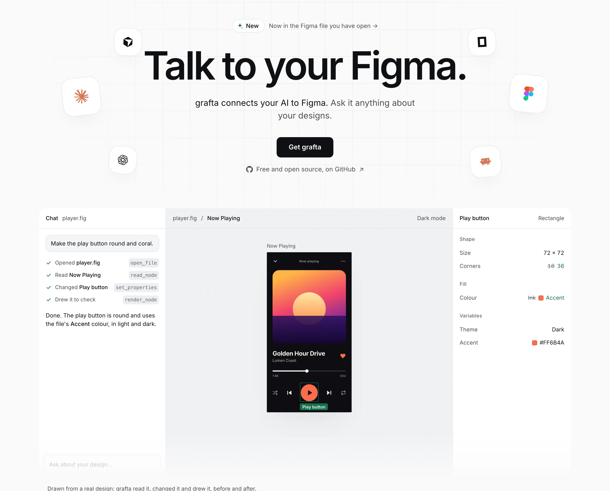

<p align="center">
  <a href="https://n0ss4.github.io/grafta/">
    
  </a>
</p>

<h1 align="center">grafta</h1>

<p align="center">Talk to your Figma.</p>

<p align="center">
  <a href="#install"><strong>Install</strong></a>&ensp;
  <a href="#in-figma">In Figma</a>&ensp;
  <a href="docs/TOOLS.md">Tools</a>&ensp;
  <a href="#documentation">Docs</a>&ensp;
  <a href="https://n0ss4.github.io/grafta/">Website</a>
</p>

<p align="center">
  <a href="https://n0ss4.github.io/grafta/">
    <picture>
      <source media="(prefers-color-scheme: dark)" srcset=".github/readme/hero-dark.webp">
      
    </picture>
  </a>
</p>

grafta connects your AI to Figma. Ask it what's in a design, change it, or turn it into code. It reads and writes Figma files exactly, on your computer, with no internet. With [its panel](#in-figma) in Figma's desktop app, it works on the file you have open too, and you see each change as it is made.

It works with Claude Desktop, Claude Code, ChatGPT desktop, Codex, Cursor, VS Code, OpenCode and any app that speaks [MCP](https://modelcontextprotocol.io) over stdio, with any model it runs.

## What you get

- **Exact values.** Every figure is read from the file's bytes: no heuristics, no model, no network. Your AI works from the real values and never guesses.
- **45 tools.** Open a file, read every node, colour, variable and component, change it, draw it to check, and save a new file that Figma opens.
- **Every Figma product.** Figma Design (`.fig`), Slides (`.deck`), FigJam (`.jam`) and Sites (`.site`), each file opened in its product to prove it.
- **Your files stay yours.** `save_as` never writes over a file and reads back what it wrote. Unsaved edits survive a restart.
- **It says what it left out.** A cut result names what is missing; a picture names what it drew approximately. Nothing is dropped silently.
- **Open.** MIT licence, no account, no API key.

## Install

| Where | Run | Needs |
|---|---|---|
| **Claude Desktop** | download [`grafta.mcpb`](https://github.com/n0ss4/grafta/releases/latest/download/grafta.mcpb) and open it | nothing else |
| **Claude Code** | `/plugin install grafta --marketplace n0ss4/grafta` | Node.js 18+ |
| **ChatGPT desktop, Codex** | `codex plugin marketplace add n0ss4/grafta@main && codex plugin add grafta@grafta` | Node.js 18+ |
| **OpenCode** | `opencode mcp add grafta --global -- npx -y grafta mcp` | Node.js 18+ |

Claude Desktop installs the bundle from *Settings → Extensions*. The Claude Code plugin registers the server and teaches the model how to use it. For OpenCode, `--global` registers it for every project; leave it out for the current one only.

### As a program

| Platform | Command |
|---|---|
| macOS, Linux | `curl -fsSL https://raw.githubusercontent.com/n0ss4/grafta/main/install.sh \| sh` |
| Homebrew | `brew install n0ss4/tap/grafta` |
| Windows | `irm https://raw.githubusercontent.com/n0ss4/grafta/main/install.ps1 \| iex` |
| npm | `npx -y grafta mcp` |
| Rust | `cargo install grafta` |

Then register it once, for example in Claude Code:

```bash
claude mcp add grafta -- grafta mcp
```

Or in a client configured with JSON:

| Client | File | Configuration |
|---|---|---|
| **Cursor** | `.cursor/mcp.json` (or `~/.cursor/mcp.json`) | `{ "mcpServers": { "grafta": { "command": "npx", "args": ["-y", "grafta", "mcp"] } } }` |
| **Claude Desktop**, by hand | `claude_desktop_config.json` | the same as Cursor |
| **VS Code** | `.vscode/mcp.json` | `{ "servers": { "grafta": { "command": "npx", "args": ["-y", "grafta", "mcp"] } } }` |

With grafta installed by the script, Homebrew or Cargo, `"command": "grafta", "args": ["mcp"]` does the same without npm.

Prebuilt for macOS (Apple silicon and Intel), Linux (x86_64 and arm64) and Windows (x86_64), as one self-contained binary. The binaries are not signed: if macOS says it cannot check grafta the first time it runs, allow it in *System Settings → Privacy & Security*. We have run it by hand on a Mac with Apple silicon, in Claude Code and Claude Desktop; the tests also pass on Linux and Windows in CI. The other apps use the same setup and have not been tried by us. ChatGPT on the web reads no local server, so it cannot use grafta yet.

If something does not work, [Troubleshooting](docs/TROUBLESHOOTING.md) goes by what you see.

### In Figma

To work on the file you have open in Figma's desktop app, add grafta's panel to Figma once. grafta must be installed in your AI app as above, the same release as the panel.

1. Download [`grafta-figma-plugin.zip`](https://github.com/n0ss4/grafta/releases/latest/download/grafta-figma-plugin.zip) and unzip it.
2. In Figma's desktop app: *Plugins → Development → Import plugin from manifest…*, and choose the `manifest.json` in that folder.
3. Open a file, then *Plugins → Development → grafta*. The panel looks for grafta on your computer.
4. With your AI app running grafta, the panel finds it and asks whether to allow it. Click **Allow**: it does not ask again on this computer.

Each change shows in the file as it is made, and Figma saves it: each call grafta makes is one step of *Edit → Undo*. The panel gathers the calls of each request and shows each one before and after, with *Revert this request* to put it all back. Choose **Ask me first** to apply or skip each change yourself, protect the layers the AI must not touch, and **Stop** refuses every call until you press Resume. It talks to grafta on your computer and to nothing else. A few tools are not there yet, such as `export_pdf` and `check_contrast`: the [tool reference](docs/TOOLS.md) says, for each, what it does on the open file. Figma in a browser has not been tried.

## Try it

Ask in words, in your AI app:

> Using grafta, what have I selected in Figma?

> Using grafta, what's in order.fig?

> Make it light, and check the contrast. Now turn it into code.

No file at hand? Use [this sample](https://n0ss4.github.io/grafta/sample/order.fig). A Figma file on your computer comes from *File → Save local copy…* in Figma. In Claude Desktop, say where the file is, like `~/Downloads/order.fig`: a file uploaded to the chat lives in Claude's cloud, so Claude copies it to a folder on your Mac that you allow, and grafta opens it there.

No AI app at hand? [Open a Figma file in your browser](https://n0ss4.github.io/grafta/open/): its pages and screens, PNGs and design tokens, with grafta running in the page and nothing uploaded.

[What to ask](docs/guides/what-to-ask.md) has prompts for code, dark mode, audits, tokens, accessibility, screens from data and decks.

## "What's the catch?"

None. grafta is free and open source, needs no Figma account or API key, and makes no network call. What your model reads through it is a tool result like any other, sent wherever your AI app sends the conversation.

It does not interpret designs: your model does. grafta answers what is in the file and writes what it is told, so how good the code is depends on your model. It writes no code itself.

## Limits

- **On a file, it is not live.** You work on a saved copy and open the new file it gives back. For the file you have open, use [the panel](#in-figma), or [Figma's own server](https://developers.figma.com/docs/figma-mcp-server/).
- **It works on files**, and with its panel on the file open in Figma's desktop app, not Figma's cloud. `new_file` takes Figma's format from a `.fig` you have; grafta does not ship it.
- **Pictures are close, not Figma's.** They use the fonts installed on your machine: with the design's font installed, most lines lay out within 2% of Figma's width; without it, a stand-in is used and the caption says so.
- **An open file costs memory**, far more than its size: on one Mac, a 57 MB file took 1.3 GB while open and an 86 MB one 5.5 GB. Close what you are done with.
- **Not yet:** auto-layout grids, component slots, boolean operations, directional transitions and mouse enter and leave in a prototype written (they are read), Dev Mode annotations, and component properties on variants.
- **Only grafta's own variables and styles can be changed.** The file's existing ones are read and bound to, not edited.

## Documentation

- [Tool reference](docs/TOOLS.md), generated from the server's own tool list ([on the website](https://n0ss4.github.io/grafta/tools/))
- [What to ask](docs/guides/what-to-ask.md), and what each family of tools does
- [Examples](docs/guides/examples.md): the four products, a frame designed in three steps, Figma to json-render
- [From Figma to json-render](docs/guides/json-render.md)
- [From a web page](docs/guides/from-a-web-page.md): HTML to editable layers with `import_layout`
- [From a terminal](docs/guides/from-a-terminal.md): the same tools without a model, and batches for CI
- [Troubleshooting](docs/TROUBLESHOOTING.md)

## Contributing

How it is built ([ARCHITECTURE](docs/ARCHITECTURE.md)), where it is going ([ROADMAP](docs/ROADMAP.md)) and how to work on it ([CONTRIBUTING](docs/CONTRIBUTING.md)). What changed is in the [CHANGELOG](CHANGELOG.md); report a vulnerability as [SECURITY](SECURITY.md) says.

## Licence

MIT. grafta is not affiliated with Figma, and reads and writes its format with no help from it.
