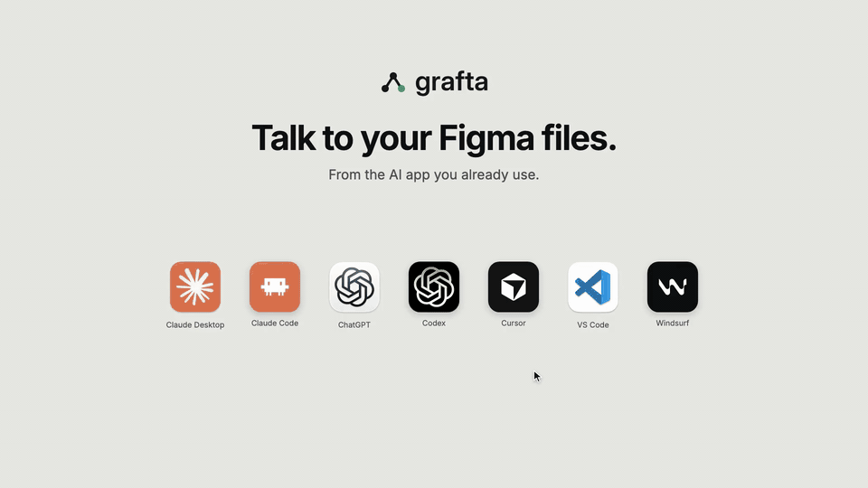
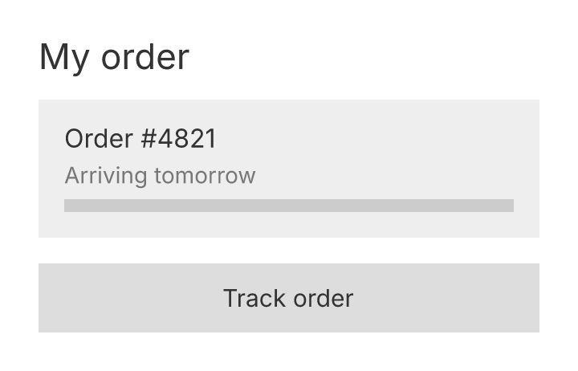
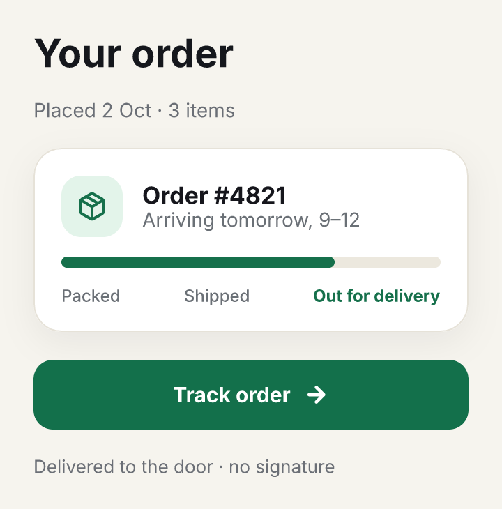
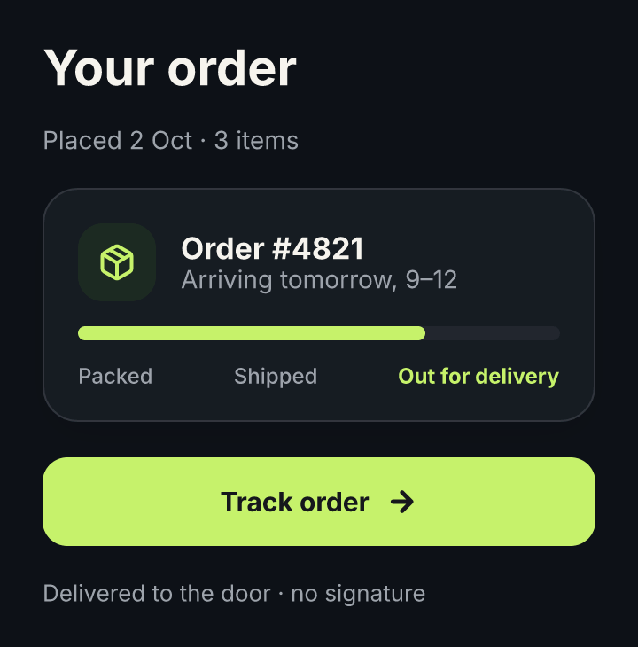
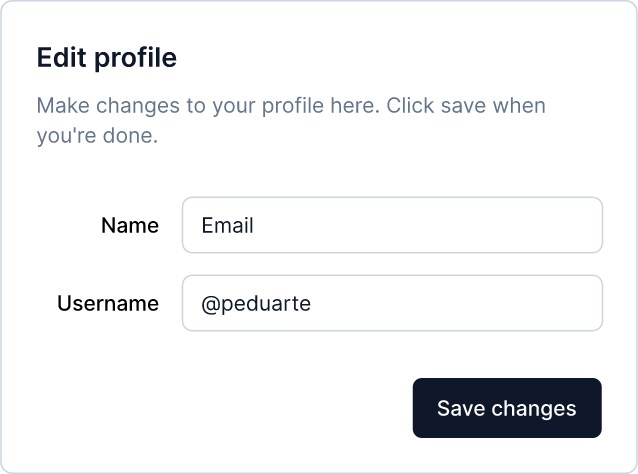
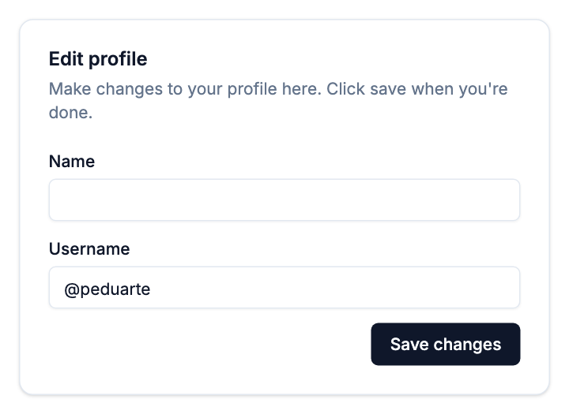
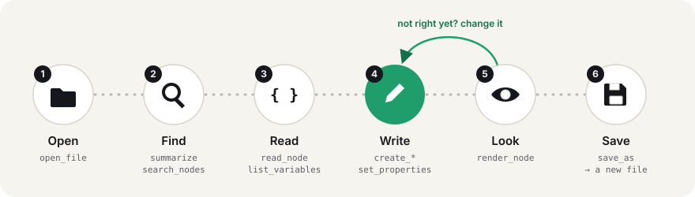

<p align="center">
  
</p>

<p align="center">
  <b>Talk to your Figma files.</b><br>
  Get a Figma file, and talk to it. Ask your AI what's in it, change it, or turn it into code, in whatever language you work in.<br>
  No Figma account, no Figma app running, no API limits.
</p>

<p align="center">
  <a href="https://n0ss4.github.io/grafta/">
    
  </a>
  <br>
  <sub>48 seconds, no sound. The requests, replies, code and pictures are from real sessions in Claude Code and Claude Desktop, shortened; the windows are drawn. <a href="https://n0ss4.github.io/grafta/">Watch it on the website</a>, with its scenes.</sub>
</p>

<p align="center">
  <a href="#try-it">Try it</a> ·
  <a href="#install">Install</a> ·
  <a href="#what-to-ask">What to ask</a> ·
  <a href="docs/TOOLS.md">Tools</a> ·
  <a href="#limits">Limits</a> ·
  <a href="#faq">FAQ</a> ·
  <a href="https://n0ss4.github.io/grafta">Website</a>
</p>

<p align="center">
  <a href="https://github.com/n0ss4/grafta/actions/workflows/ci.yml"></a>
  <a href="LICENSE"></a>
  
</p>

**What is it?** A free, open-source tool your AI app uses: Claude, Cursor, Codex and others. It connects through [MCP](https://modelcontextprotocol.io), the way AI apps connect to tools. It reads a Figma file on your computer exactly, so your AI works from the real values and never guesses.

**What is a `.fig`?** A Figma file. In Figma: *File → Save local copy…* Somebody may also just send you one. Slides, FigJam and Sites files work too.

**Is it for me?** If you have a Figma file and an AI app. A designer changes it, a developer turns it into code, and someone who was sent it asks what it is.

## Try it

1. [Install grafta](#install) in your AI app.
2. Get a file: yours, or [this sample](https://n0ss4.github.io/grafta/sample/order.fig), the card in the video.
3. Ask, in words:

   > Using grafta, what's in order.fig?

   > Make it light, and check the contrast.

   > Now turn it into code.

In Claude Desktop, say where the file is, like `~/Downloads/order.fig`. A file uploaded to the chat lives in Claude's cloud, so Claude copies it to a folder on your Mac that you allow, and grafta opens it there.

grafta never writes over your file: it saves a new one, and reads it back before it says it is done. Open it in Figma to see it. How good the code is depends on your AI: grafta gives it exact values, and writes no code itself.

## Install

| Where | Run |
|---|---|
| **Claude Desktop** | download [`grafta.mcpb`](https://github.com/n0ss4/grafta/releases/latest/download/grafta.mcpb) and open it |
| **Claude Code** | `/plugin install grafta --marketplace n0ss4/grafta` |
| **ChatGPT desktop, Codex** | `codex plugin marketplace add n0ss4/grafta@main && codex plugin add grafta@grafta` |
| **macOS, Linux** | `curl -fsSL https://raw.githubusercontent.com/n0ss4/grafta/main/install.sh \| sh` |
| **Homebrew** | `brew install n0ss4/tap/grafta` |
| **Windows** | `irm https://raw.githubusercontent.com/n0ss4/grafta/main/install.ps1 \| iex` |
| **npm** | `npx -y grafta mcp` |
| **Rust** | `cargo install grafta` |

Claude Desktop installs the bundle from *Settings → Extensions* when you open
it; no terminal and no Node.js. The binaries are not signed: if macOS says it cannot check grafta
the first time it runs, allow it in *System Settings → Privacy & Security*.
If something does not work, [Troubleshooting](docs/TROUBLESHOOTING.md) goes by what you see.

The Claude Code plugin registers the server and teaches the model how to use it.
Anywhere else, register it once:

```bash
claude mcp add grafta -- grafta mcp
```

Or, in a client configured with JSON:

| Client | File | Configuration |
|---|---|---|
| **Cursor** | `.cursor/mcp.json` (or `~/.cursor/mcp.json`) | `{ "mcpServers": { "grafta": { "command": "npx", "args": ["-y", "grafta", "mcp"] } } }` |
| **Windsurf** | `~/.codeium/windsurf/mcp_config.json` | the same as Cursor |
| **Claude Desktop**, by hand | `claude_desktop_config.json` | the same as Cursor |
| **VS Code** | `.vscode/mcp.json` | `{ "servers": { "grafta": { "command": "npx", "args": ["-y", "grafta", "mcp"] } } }` |

With grafta installed by the script, Homebrew or Cargo, `"command": "grafta", "args": ["mcp"]` does the same without npm.

Prebuilt for macOS (Apple silicon and Intel), Linux (x86_64 and arm64) and
Windows (x86_64). One self-contained binary. We have run it by hand on a Mac with
Apple silicon; the tests also pass on Linux and Windows in CI. Claude Code, Cursor,
VS Code, Windsurf, Codex and the ChatGPT desktop app start it with `npx`, which needs
Node.js 18 or newer. We have tried Claude Code and Claude Desktop; the others use the
same setup. ChatGPT on the web reads no local server, so it cannot use grafta yet.

## Why

A model is good at reading intent into a design and deciding what to build. It
is bad at binary formats, and it guesses numbers. grafta is the opposite. It gives your model 44 tools
to open a `.fig`, read every node, colour, variable and component in it, change
it, draw it to check, and save a new file that Figma opens.

## Four products

The same tools open, read, draw and save every file Figma saves, and each
product's files were opened in that product to prove it.

| Product | File | What grafta speaks |
|---|---|---|
| **Figma Design** | `.fig` | screens, components and variants, variables with modes, styles, auto-layout, rich text, images, vectors |
| **Figma Slides** | `.deck` | slides in their grid, speaker notes, templates; transitions and object animations, kept when slides move |
| **FigJam** | `.jam` | stickies, shapes with text, connectors between nodes, sections, tables, stamps |
| **Figma Sites** | `.site` | a site's pages by route, each holding its breakpoints; inside a breakpoint, every tool works as on a frame |

## See it

The same frame, three times. Each picture is grafta's own `render_node`; every
change between them is a tool call a model would make
([58 of them](docs/showcase/showcase.py)).

| A draft | Designed | Dark mode |
|:---:|:---:|:---:|
|  |  |  |
| frames and text | 9 colour variables, Lucide icons, auto-layout | one property on the frame: `explicitVariableModes` |

### From Figma to json-render

A screen in a Figma file, written as a [json-render](https://github.com/vercel-labs/json-render)
spec, the JSON an AI writes and json-render draws with your components. Left, the
*Edit profile* dialog in the shadcn/ui Figma kit; right, the spec your AI wrote from
it with grafta, drawn by json-render's shadcn components.

| In Figma | Drawn by json-render |
|:---:|:---:|
|  |  |

How, step by step, and what does not match: [From Figma to json-render](docs/guides/json-render.md).

## How a model works with it



Results are bounded: when something is left out, the result says so under
`omitted` and how to get it. Nothing is truncated silently.

## What to ask

Prompts that work as written. The model chooses the tools.

| Job | Ask | Tools it reaches for |
|---|---|---|
| **Understand it** | *Open handoff.fig with grafta. What's in it, how is it organised, and which colours and components does it use?* | `summarize`, `search_nodes`, `read_node` |
| **Turn it into code** | *Open checkout.fig with grafta. Build the payment screen in our stack, with the file's exact sizes, colours and icons.* | `read_node`, `list_variables`, `render_node` |
| **A json-render spec** | *Using grafta, open shadcn.fig and write the dialog as a json-render spec for @json-render/shadcn's catalog.* ([guide](docs/guides/json-render.md)) | `search_nodes`, `read_node`, `render_node` |
| **Dark mode** | *Open app.fig with grafta. Turn the colours on the Settings screen into Light and Dark variables, bind every fill to them, render both modes, and save as app-dark.fig.* | `create_variable` `set_properties` `render_node` |
| **Design-system audit** | *Open library.fig with grafta. List its components, variables and styles, and tell me which colours are used on screens without being a variable or a style.* | `list_components` `list_variables` `search_nodes` |
| **Accessibility** | *Open checkout.fig with grafta and check every screen's text contrast against WCAG AA. Fix what fails with the file's own colours, and show me before and after.* | `check_contrast` `set_properties` `render_node` |
| **Screens from data** | *Open shop.fig with grafta. Place the Product card component once per row of products.csv in a wrapping grid, with each row's name, price and photo.* | `fill_template` |
| **HTML to layers** | *Import page.json, a snapshot of our landing page, into a new page of site.fig with grafta.* | `import_layout` |
| **A deck** | *Open pitch.deck with grafta. Add three slides after the title with our Q3 numbers, a fade between them, and speaker notes; then export every slide as one PDF.* | `duplicate_node` `set_properties` `export_pdf` |

## What it can do

| Job | Tools | |
|---|---|---|
| **Find your way** | `open_file` `summarize` `list_screens` `search_nodes` `list_open` `close_file` | pages, a page's screens (a deck's slides, a site's breakpoints), counts, nodes by name or type, with their path |
| **Read** | `read_node` `read_raw` `list_components` `component_instances` `get_image` | a node exactly, in the Figma plugin API's names |
| **See** | `render_node` `export_pdf` `check_contrast` | a frame as a PNG, unsaved edits included, in its variable mode; frames as a vector PDF, a page each; every text's WCAG AA contrast against what is drawn behind it |
| **Draw** | `create_page` `create_frame` `create_text` `create_shape` `create_vector` `create_instance` `create_section` | frames, rich text, shapes, SVG icons, instances |
| **Import** | `import_layout` | a web page's layout as frames, text, images and auto-layout, from a snapshot a browser takes ([below](#from-a-web-page)) |
| **Change** | `set_properties` `override_instance` `move_node` `duplicate_node` `group_nodes` `ungroup` `delete_node` | fills, strokes, effects, auto-layout, sizing, constraints, images, order |
| **Design system** | `create_component` `create_variant_set` `set_variant` `add_component_property` `fill_template` | components, variants and their properties; a component placed once per row of JSON or CSV |
| **Tokens** | `list_variables` `create_variable_collection` `create_variable` `set_variable` `set_variable_collection` | collections with modes (Light, Dark), aliases, bindings |
| **Styles** | `list_styles` `create_style` `set_style` | colour, text and effect styles |
| **Save** | `new_file` `save_as` | a new file from nothing, or the open one with its edits |

Every tool, with its arguments, is in the [tool reference](docs/TOOLS.md),
generated from the server's own tool list
([on the website](https://n0ss4.github.io/grafta/tools/)); `grafta tool`
lists them in a terminal.

## Why it can be trusted

| Promise | What it means |
|---|---|
| **Exact** | every figure is read from the file's bytes: no heuristics, no model, no network |
| **Says what it left out** | a cut result names what is missing; a picture names what it drew approximately |
| **Does not write over your files** | `save_as` refuses an existing path, except the empty file `new_file` just made, and re-reads what it wrote |
| **Survives restarts** | unsaved edits are journaled as they are made (`~/.grafta/journals`) and replayed on reopen |
| **Refuses rather than breaks** | it will not delete a node something points into, or write what Figma would repair; it says why |

## Limits

- **It does not interpret designs.** Your model does. grafta answers what is in
  the file, and writes what it is told.
- **It is not live, and not collaborative.** You work on a saved copy, and open the new file it gives back. For the live file, use [Figma's own server](https://developers.figma.com/docs/figma-mcp-server/).
- **How good the code is depends on your model.** grafta gives it exact values, and writes no code itself. Figma's server and [Framelink](https://github.com/GLips/Figma-Context-MCP) also serve design to code, from a Figma link, with an account.
- **It is not affiliated with Figma**, and reads and writes its format with no help from it.
- **It works on files**, not Figma's cloud: `.fig` from Figma Design, `.deck`
  from Figma Slides, `.jam` from FigJam and `.site` from Figma Sites. Save a local copy, and open the result in Figma. `new_file` takes Figma's format from a `.fig` you have;
  grafta does not ship it.
- **Pictures are close, not Figma's.** They use the fonts installed on your
  machine: with the design's font installed, most lines lay out within 2% of
  Figma's width; without it, a
  stand-in is used and the caption says so. Install the
  font and restart the server.
- **An open file costs memory**, far more than its size: on one Mac, a 57 MB file took 1.3 GB
  while open and an 86 MB one 5.5 GB. Close what you
  are done with.
- **Not yet:** auto-layout grids, component slots, boolean operations,
  directional transitions and mouse enter and leave in a prototype written
  (they are read), Dev Mode annotations, and component properties on variants.
- **Only grafta's own variables and styles can be changed.** The file's existing
  ones are read and bound to, not edited.

## From a web page

`import_layout` turns HTML into an editable design: flexbox becomes auto-layout,
sized fill, hug or fixed as the browser measured it. grafta runs no browser; a
browser takes a snapshot of what it laid out, and grafta reads that.

```bash
curl -fsSLO https://n0ss4.github.io/grafta/snapshot.sh && curl -fsSLO https://n0ss4.github.io/grafta/snapshot.js
sh snapshot.sh page.html page.json 'main'     # headless Chrome; a CSS selector picks the part
```

Or, in any browser console or a model's browser tool, paste
[`snapshot.js`](scripts/snapshot.js) and run `copy(JSON.stringify(graftaSnapshot('main')))`.
Then ask the model to import `page.json`. What does not map (a gradient, a
transform, an inline SVG, a remote image) is listed, not guessed.

## From a terminal

The same tools, without a model:

```bash
grafta tool                                     # list the tools
grafta tool read_node                           # what one takes, with an example
grafta tool open_file '{"path":"design.fig"}'   # call one: each call starts afresh
grafta tool --batch calls.json                  # a sequence on one open file
```

A batch is a JSON array of `{ "tool", "args", "out"? }`; `"$0.handle"` in an
argument is call 0's result field, and `"out"` writes a picture to a file. The
[showcase](docs/showcase/showcase.py) is one.

## FAQ

**Do I need a Figma account or an API key?** No. grafta works on the file on
your disk. You need Figma only to save a local copy and to open the result.

**Does my file leave my machine?** grafta makes no network call. What your
model reads through it is a tool result like any other, sent wherever your MCP
client sends the conversation.

**Can it break my file?** It does not write over one: `save_as` refuses a path
that exists and reads back what it wrote. It refuses what Figma would have to
repair, and unsaved edits survive a restart.

**Which clients and models?** Any MCP client over stdio (Claude Desktop,
Claude Code, Cursor, VS Code, Windsurf…) with any model it runs.

**Is it affiliated with Figma?** No. It is free and open source, under the MIT
licence.

## Contributing

How it is built ([ARCHITECTURE](docs/ARCHITECTURE.md)), where it is going
([ROADMAP](docs/ROADMAP.md)) and how to work on it
([CONTRIBUTING](docs/CONTRIBUTING.md)). What changed is in the
[CHANGELOG](CHANGELOG.md); report a vulnerability as [SECURITY](SECURITY.md)
says.

MIT licence. Not affiliated with Figma.
