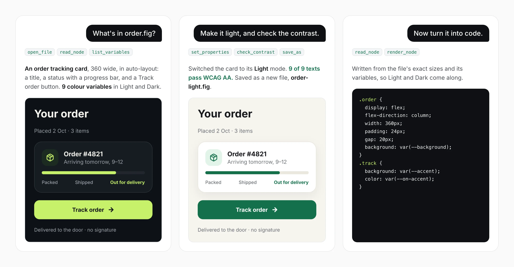

  

<h1 align="center">grafta</h1>

Talk to your Figma.

  <a href="#install"><strong>Install</strong></a>&ensp;
  <a href="docs/guides/in-figma.md">In Figma</a>&ensp;
  <a href="docs/TOOLS.md">Tools</a>&ensp;
  <a href="#documentation">Docs</a>&ensp;
  <a href="https://n0ss4.github.io/grafta/">Website</a>

  <picture>
    <source media="(prefers-color-scheme: dark)" srcset=".github/readme/talk-dark.webp">
    
  </picture>

**Talk to your Figma files through the AI you already use.** Ask Claude, ChatGPT, Cursor or OpenCode what's in a design, ask it to change something, or to turn it into code. You write in words; grafta lets your AI open the file, read it exactly and change it.

It works on your computer, with no internet and no Figma account. With [its panel](docs/guides/in-figma.md) in Figma's desktop app, it works on the file you have open too, and you see each change as it is made.

## What you get

- **Ask what's in a design.** Its screens, colours, variables and components, in plain words.
- **Change it by asking.** Colours, text, layout, a dark mode, a new screen. Your AI draws the result to check it.
- **Turn it into code.** In your stack, with the file's exact sizes, colours and icons.
- **Never guessed.** Every value comes from the file. When grafta leaves something out, it says so.
- **Your files stay yours.** Changes are saved as a new file, never over yours.
- **Every Figma product.** Figma Design, Slides, FigJam and Sites files.
- **Free and open source.** MIT licence, no account, no API key.

## Install

| Your AI app | Run |
|---|---|
| **Claude Desktop** | download [`grafta.mcpb`](https://github.com/n0ss4/grafta/releases/latest/download/grafta.mcpb) and open it |
| **Claude Code** | `/plugin install grafta --marketplace n0ss4/grafta` |
| **ChatGPT desktop, Codex** | `codex plugin marketplace add n0ss4/grafta@main && codex plugin add grafta@grafta` |
| **OpenCode** | `opencode mcp add grafta --global -- npx -y grafta mcp` |

Then ask, in words: *Using grafta, what have I selected in Figma?*

Cursor, VS Code, the program for macOS, Linux and Windows, and what each needs: [Install](docs/INSTALL.md). For the file you have open, add [grafta's panel](docs/guides/in-figma.md) to Figma's desktop app.

## "What's the catch?"

None. grafta is free and open source, needs no account and makes no network call. It does not interpret designs: your model does, so how good the code is depends on your model. What it cannot do yet is in [Limits](docs/LIMITS.md).

## Documentation

- [Install](docs/INSTALL.md)
- [In Figma](docs/guides/in-figma.md): the panel for the file you have open
- [What to ask](docs/guides/what-to-ask.md)
- [Tool reference](docs/TOOLS.md)
- [Examples](docs/guides/examples.md)
- [From a web page](docs/guides/from-a-web-page.md) and [from a terminal](docs/guides/from-a-terminal.md)
- [Limits](docs/LIMITS.md) and [Troubleshooting](docs/TROUBLESHOOTING.md)

## Contributing

Read [CONTRIBUTING](docs/CONTRIBUTING.md) and [ARCHITECTURE](docs/ARCHITECTURE.md). Where it is going: [ROADMAP](docs/ROADMAP.md). Report a vulnerability as [SECURITY](SECURITY.md) says.

## Licence

MIT. grafta is not affiliated with Figma.
