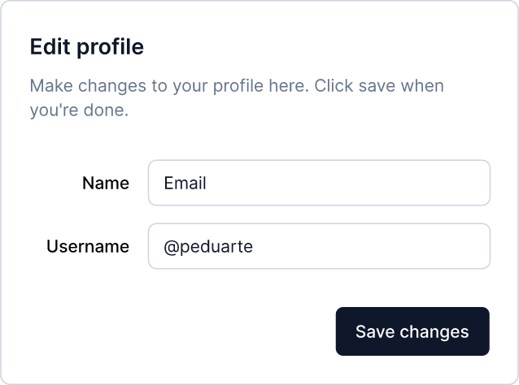
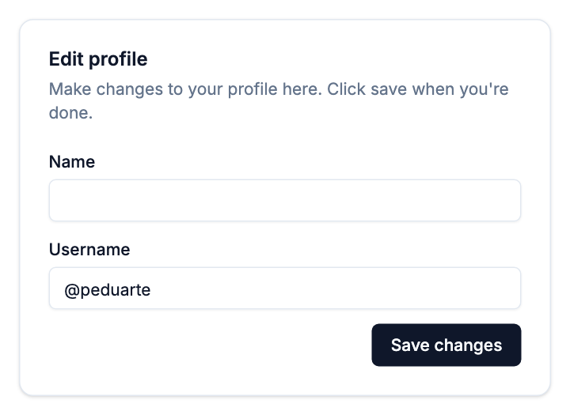

# From Figma to json-render

Turn a screen in a Figma file into a [json-render](https://github.com/vercel-labs/json-render)
spec: the JSON that json-render draws with your components.

| In Figma | Drawn by json-render |
|---|---|
|  |  |

The left is the *Edit profile* dialog from the
[shadcn/ui Figma kit](https://ui.shadcn.com/figma) by Pietro Schirano. The right is the
spec below, drawn by json-render 0.22.0 with `@json-render/shadcn`.

## What you need

- The Figma file, saved from Figma with *File → Save local copy…*
- grafta in your AI app: see [Install](../../README.md#install).
- A React project with `@json-render/core`, `@json-render/react` and
  `@json-render/shadcn`.

## 1. Ask

> Using grafta, open shadcn.fig and find the dialog called "dialog". Write it as a
> json-render spec for @json-render/shadcn's catalog.

grafta reads the screen exactly: every layer, its text, its layout, and which
component each piece is. Your AI turns that into the spec. grafta writes no code
itself.

## 2. What your AI does

It goes through the screen and picks, for each part, the catalog component that
does the same job:

| In the Figma file | In the spec |
|---|---|
| The dialog frame, with a title "Edit profile" and a line of text under it | A `Card` with `title` and `description` |
| A frame stacking the fields, auto-layout vertical, 16 px apart | A `Stack`, `direction: "vertical"`, `gap: "lg"` |
| Two instances of `input/small`, beside the texts "Name" and "Username" | Two `Input`s, with those texts as `label` |
| The text in the Username field, "@peduarte" | The field's value, kept in the spec's `state` |
| A frame aligned to the end, holding an instance of `button` (type default) with the text "Save changes" | A `Stack`, `justify: "end"`, with a `Button`, `variant: "primary"` |

## 3. The spec

```json
{
  "root": "dialog",
  "elements": {
    "dialog": {
      "type": "Card",
      "props": {
        "title": "Edit profile",
        "description": "Make changes to your profile here. Click save when you're done.",
        "maxWidth": "lg", "centered": null, "className": null
      },
      "children": ["fields", "actions"]
    },
    "fields": {
      "type": "Stack",
      "props": { "direction": "vertical", "gap": "lg", "align": "stretch", "justify": null, "className": null },
      "children": ["name", "username"]
    },
    "name": {
      "type": "Input",
      "props": {
        "label": "Name", "name": "name", "type": "text", "placeholder": null,
        "value": { "$bindState": "/profile/name" }, "checks": null, "validateOn": null
      },
      "children": []
    },
    "username": {
      "type": "Input",
      "props": {
        "label": "Username", "name": "username", "type": "text", "placeholder": null,
        "value": { "$bindState": "/profile/username" }, "checks": null, "validateOn": null
      },
      "children": []
    },
    "actions": {
      "type": "Stack",
      "props": { "direction": "horizontal", "gap": "sm", "align": null, "justify": "end", "className": null },
      "children": ["save"]
    },
    "save": {
      "type": "Button",
      "props": { "label": "Save changes", "variant": "primary", "disabled": null },
      "children": []
    }
  },
  "state": {
    "profile": { "name": "", "username": "@peduarte" }
  }
}
```

A field's value goes in `state` and the field binds to it with `$bindState`: a value
written straight into the field's props is not shown.

## 4. Draw it

```tsx
import { defineCatalog } from "@json-render/core";
import { defineRegistry, JSONUIProvider, Renderer } from "@json-render/react";
import { schema } from "@json-render/react/schema";
import { shadcnComponents } from "@json-render/shadcn";
import { shadcnComponentDefinitions } from "@json-render/shadcn/catalog";
import spec from "./edit-profile.json";

const catalog = defineCatalog(schema, { components: shadcnComponentDefinitions, actions: {} });
const { registry } = defineRegistry(catalog, { components: shadcnComponents });

export function EditProfile() {
  return (
    <JSONUIProvider registry={registry} initialState={spec.state}>
      <Renderer spec={spec} registry={registry} />
    </JSONUIProvider>
  );
}
```

## What does not match, and why

- **The labels sit above the fields**, not to their left. The catalog's `Input`
  always draws its label above it. To match the file, add a component of your own to
  the catalog.
- **The Name field is empty.** In the file it shows "Email": that field kept its
  component's text, which nobody changed for a name. Your AI should tell you when
  a text looks left over like this, and not copy it.
- **Colours, fonts and corners come from your shadcn theme**, not from the spec. For
  the picture above, the theme was set to the file's slate colours. Ask your AI to
  read the file's styles (`list_styles`) and write them into your theme.
- **The catalog has less than your design system.** Its `Button` has three variants:
  primary, secondary and danger. If a screen uses an outline or ghost button, add
  those to the catalog first. The same file tells your AI which variants exist:
  `read_node` on its `button` component set lists them.

## Check it

`catalog.validate(spec)` checks each element's `type`. With more than one component
in the catalog, it does not check their props. To check those too:

```ts
export function check(spec) {
  const result = catalog.validate(spec);
  if (!result.success) return result.error.issues;
  return Object.entries(spec.elements).flatMap(([id, el]) => {
    // A value read from state, {"$bindState": "/path"} and the like, is checked when drawn.
    const literal = Object.fromEntries(Object.entries(el.props).map(([k, v]) =>
      [k, v && typeof v === "object" && Object.keys(v).some((x) => x.startsWith("$")) ? null : v]));
    const props = catalog.data.components[el.type].props.strict().safeParse(literal);
    return props.success ? [] : props.error.issues.map((i) => ({ ...i, path: [id, ...i.path] }));
  });
}
```

The spec above passes with no issues.
